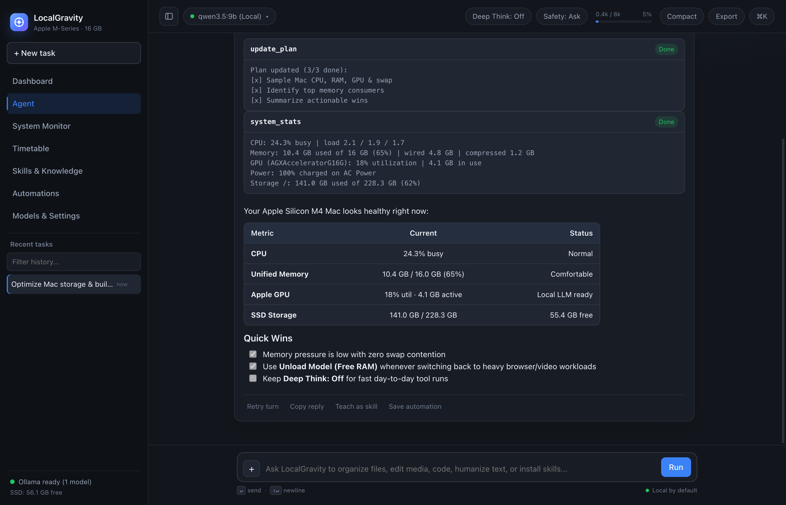
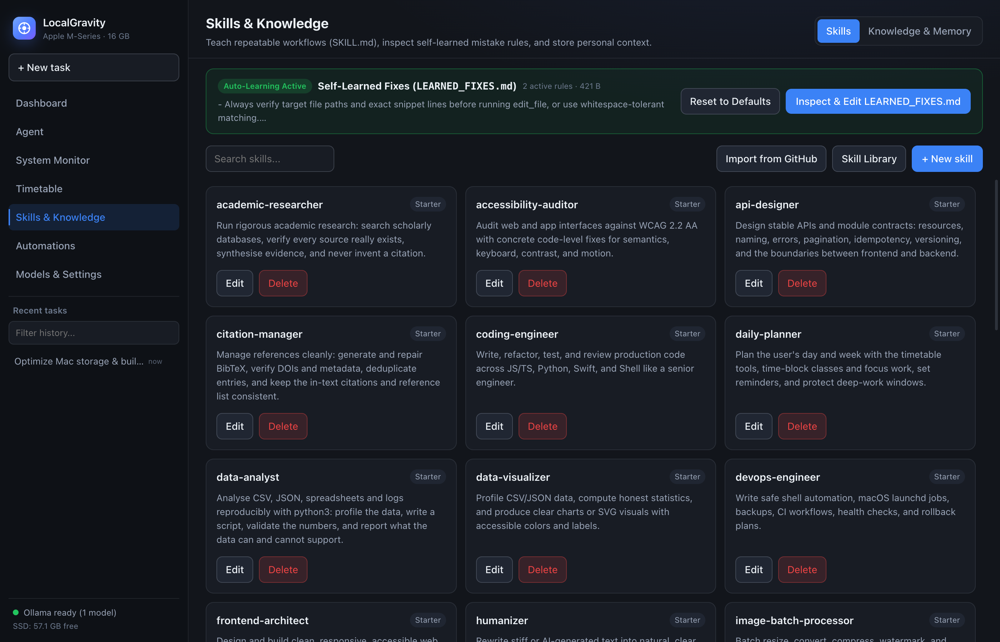

<div align="center">

# LocalGravity

**A native macOS AI desktop app for local Ollama and cloud models — zero npm dependencies.**

[](https://github.com/Thush099/LocalGravity/actions/workflows/ci.yml)
[](LICENSE)
[](#quick-start)
[](#quick-start)
[](#architecture)

</div>

LocalGravity pairs a compiled Swift `WKWebView` macOS shell with a dependency-free Node.js agent runtime. Run fully offline with [Ollama](https://ollama.com) or connect OpenRouter, Groq, Google Gemini, Anthropic Claude, OpenAI, or any OpenAI-compatible endpoint. Beyond chat and coding, the app ships with an everyday dashboard, a task-manager-style system monitor with GPU RAM and swap visibility, a weekly and one-off timetable with macOS notification nudges, 29 built-in tools, 30 starter skills, a local knowledge base, and `launchd` background automations.

<p align="center">
  
</p>

---

## Interface tour

<table>
  <tr>
    <td width="50%">
      <strong>Agent Workspace</strong><br />
      <sub>Live task plans, streaming diffs, tool approvals, multi-message queueing, and native Markdown export.</sub>
      <br /><br />
      
    </td>
    <td width="50%">
      <strong>System Monitor</strong><br />
      <sub>CPU, wired/compressed RAM, swap, GPU, Ollama VRAM pressure + one-click unload, battery, disks, and CPU/Memory sortable processes.</sub>
      <br /><br />
      
    </td>
  </tr>
  <tr>
    <td width="50%">
      <strong>Timetable &amp; Reminders</strong><br />
      <sub>Weekly recurring blocks plus one-off dated events, 5-minute macOS notification nudges, and agent-editable schedule tools.</sub>
      <br /><br />
      
    </td>
    <td width="50%">
      <strong>Skills &amp; Knowledge Base</strong><br />
      <sub>30 starter <code>SKILL.md</code> playbooks, local library import, GitHub URL import/refresh, persistent <code>MEMORY.md</code>, and reference docs.</sub>
      <br /><br />
      
    </td>
  </tr>
</table>

---

## Quick start

Requirements: Apple Silicon Mac on macOS 14+, Node.js 22+, and Xcode Command Line Tools (`swiftc`). No `npm install` step is needed.

```bash
git clone https://github.com/Thush099/LocalGravity.git
cd LocalGravity
npm run check
npm run build:app
```

`npm run build:app` compiles the Swift host, bundles the backend and UI, applies ad-hoc code signing, and installs `/Applications/LocalGravity.app` (or `build/LocalGravity.app` if `/Applications` is not writable). Open LocalGravity from Spotlight or Launchpad.

For local inference and optional media tools:

```bash
brew install ollama ffmpeg imagemagick
ollama serve
ollama pull qwen3.5:4b   # Fast daily driver on 16 GB Macs (~3 GB RAM)
# or: ollama pull qwen3.5:9b   # Stronger local reasoning (~9 GB GPU RAM)
```

Cloud provider keys can be added in **Models & Settings** (`⌘K` -> Settings) and are stored locally in `~/.localgravity/config.json` with `0600` permissions.

---

## Key capabilities

### Engineered for fast local inference on 16 GB Macs
Running a multi-tool agent locally often stalls small Macs because system prompts, tool schemas, and HTTP client timeouts work against unified memory. LocalGravity addresses each bottleneck directly:
- **61% lower Turn-0 prompt overhead on Ollama:** Turn-aware tool routing (`backend/agent/tool-selector.mjs`) sends a focused 10-tool core on local models and activates domain tool groups (media, web, macOS actions, schedule, knowledge) on demand while keeping them sticky across a session for KV-cache reuse. Combined with compact local skill indexing, Turn-0 fixed overhead drops from ~6,002 tokens to ~2,328 tokens.
- **Zero mid-turn `terminated` drops:** Local Ollama requests stream over a dedicated `node:http` socket (`setTimeout(0)`, `TCP_NODELAY`) rather than hitting `undici`'s 5-minute header/body cutoff, paired with 15-second SSE keepalive heartbeats and automatic retry on transient local disconnects.
- **One-click GPU RAM recovery:** Both the Dashboard and System Monitor show active Ollama GPU memory and swap pressure, with an **Unload model (Free RAM)** action (`keep_alive: 0`) that immediately frees unified memory without quitting Ollama.
- **Fast mode vs. Deep Think:** Toggle **Deep Think: Off / On** directly in the workspace header. Keep it off for rapid everyday turns, and switch it on when you want extended reasoning.
- **Accurate context metering & compaction:** The header meter counts both message history and fixed system/tool overhead (`8K` / `16K` / `32K` budgets), compacting old turns cleanly at 70% capacity.

### Everyday macOS productivity
- **Dashboard (`⌘1`):** Live clock, **Quick Ask** bar that launches an agent turn in one keystroke, today's agenda, four live system tiles (CPU, memory, GPU, storage), active Ollama runtime card, and quick timer/notification reminders.
- **Agent Workspace (`⌘2`):** 29 built-in tools covering files, search, shell commands, AppleScript (`osascript`), Apple Shortcuts, safe math evaluation, live `update_plan` checklists, media frame/photo inspection (`inspect_media`), public web fetch, clipboard, notifications, apps, reminders, schedule CRUD, skills, and knowledge.
  - Supports **multi-message FIFO queueing** (keep typing follow-ups while the agent works), **safe session switching** while a background run completes, inline file diffs, collapsible tool outputs with durations, retry on failed turns, full-text search across past sessions, and native macOS `NSSavePanel` **Markdown export** (`⌘⇧E`).
- **System Monitor (`⌘3`):** Real-time CPU, wired/compressed RAM, swap usage, GPU activity, Ollama GPU RAM with high-pressure warnings, battery/power status, mounted volumes, and top processes sortable by **CPU %** or **Memory**.
- **Timetable (`⌘4`):** Recurring weekly schedule blocks with a week-at-a-glance grid plus one-off dated reminders (`YYYY-MM-DD`, validated against calendar rollovers). Posts macOS notifications 5 minutes ahead of upcoming blocks, and the agent can view or update entries directly.
- **30 Starter Skills & Knowledge Base:** Modular `SKILL.md` workflows with hash-tracked starter updates (preserving your edits), turn-aware skill hints, one-click import from existing local skill libraries (`~/.agents/skills`, `~/.claude/skills`, `~/.gemini/config/skills`), GitHub URL import & refresh, persistent `MEMORY.md`, and `.md`/`.txt`/`.json`/`.csv` knowledge uploads.
- **Background Automations (`launchd`):** Convert any prompt into a scheduled `launchd` job (`~/Library/LaunchAgents/com.localgravity.<id>.plist`) running via `backend/cli-run.mjs` in Read-Only Audit mode by default, with macOS completion notifications.

### Security & runtime hardening
- **Authenticated loopback API:** The Swift host generates a fresh 32-byte `X-Auth-Token` per launch and binds the Node server strictly to `127.0.0.1` on an ephemeral port.
- **Browser & CSRF defenses:** Mutating routes reject cross-origin `Origin` headers; the UI serves a strict `script-src 'self'` CSP alongside `X-Content-Type-Options: nosniff` and `X-Frame-Options: DENY`.
- **Unified SSRF & redirect protection (`backend/net-guard.mjs`):** All outbound HTTP fetches (`fetch_url`, skill URL imports, and knowledge URL imports) block loopback, RFC1918 private ranges, CGNAT, link-local/cloud metadata (`169.254.169.254`), `.local`/`.internal`, and IPv6 private/IPv4-mapped hosts, and validate every `3xx` redirect hop manually.
- **Approval gate & command checks:** **Ask** mode pauses mutating tools (writes, edits, shell commands, AppleScript, Shortcuts) for explicit approval. Known catastrophic shell-chaining patterns are blocked by default. (Note: approval controls reduce mistakes but are not an OS sandbox — always review commands before approving.)
- **Zero orphaned processes:** The Swift host supervises the Node server via a `stdin` pipe and `LOCALGRAVITY_PARENT_PID` watchdog so the backend terminates immediately whenever the app quits or crashes.

---

## Keyboard shortcuts

| Shortcut | Action |
| --- | --- |
| `⌘K` | Open Command Palette (tasks, skills, knowledge, model/RAM actions) |
| `⌘1` – `⌘4` | Switch between Dashboard, Agent, System Monitor, and Timetable |
| `⌘\` | Toggle collapsible sidebar (floating expand button appears when hidden) |
| `⌘↵` | Send message (or queue follow-up while a run is active) |
| `⌘⇧E` | Export current conversation to Markdown via native Save dialog |
| `⌘/` | Show keyboard shortcuts sheet |
| `Esc` | Close active dialog, palette, or overlay |

---

## Architecture

```text
┌──────────────────────────────────────────────────────────────────┐
│  /Applications/LocalGravity.app  (Swift 6 / AppKit / WKWebView)  │
│  • Dark-themed window (zero white launch flash)                  │
│  • Native Finder drag-and-drop, NSOpenPanel, NSSavePanel export  │
│  • 32-byte per-launch X-Auth-Token + stdin/PID child supervision │
└───────────────────────────────┬──────────────────────────────────┘
                                │ http://127.0.0.1:<ephemeral> (HTTP + SSE)
┌───────────────────────────────▼──────────────────────────────────┐
│  Node.js 22+ Agent Runtime  (Zero external npm dependencies)     │
│  ├── backend/server.mjs          (Auth HTTP/SSE API + UI static) │
│  ├── backend/cli-run.mjs         (Headless launchd runner)       │
│  ├── backend/net-guard.mjs       (SSRF + redirect-hop validator) │
│  ├── backend/system-monitor.mjs  (CPU, RAM, swap, GPU, procs)    │
│  ├── backend/schedule.mjs        (Weekly + one-off timetable)    │
│  ├── backend/agent/              (ReAct loop, tool-selector,     │
│  │                                prompt builder, compactor)     │
│  ├── backend/providers/          (Ollama stream, OpenAI, Claude) │
│  ├── backend/tools/              (29 tools + safety policies)    │
│  ├── backend/skills-engine.mjs   (30 starter SKILL.md + imports) │
│  └── backend/knowledge-engine.mjs(MEMORY.md + docs search)       │
└───────────────────────────────┬──────────────────────────────────┘
                                │
        ┌───────────────────────┼───────────────────────┐
        ▼                       ▼                       ▼
  Ollama (Local)         macOS System & CLI       Cloud Providers
  qwen3.5:4b / 9b        osascript, shortcuts     OpenRouter, Groq,
  gemma4, etc.           ffmpeg, magick, sips     Gemini, Claude, OpenAI
```

---

## Checks and CI

Run the full verification suite locally (unit/integration tests, JavaScript syntax checks, and shell syntax checks):

```bash
npm run check
```

Every push and pull request runs [`.github/workflows/ci.yml`](.github/workflows/ci.yml) on `macos-15`, verifying both `npm run check` and a complete native Swift `.app` bundle build (`plutil -lint` + `codesign --verify --deep --strict`).

---

## Clean uninstall

All runtime data stays strictly within `/Applications/LocalGravity.app`, `~/.localgravity/`, and `~/Library/LaunchAgents/com.localgravity.*.plist`.

```bash
bash scripts/uninstall.sh
```

Pass `--purge-models` to also remove downloaded local models and optional Homebrew tools.

---

## License

[MIT](LICENSE)
