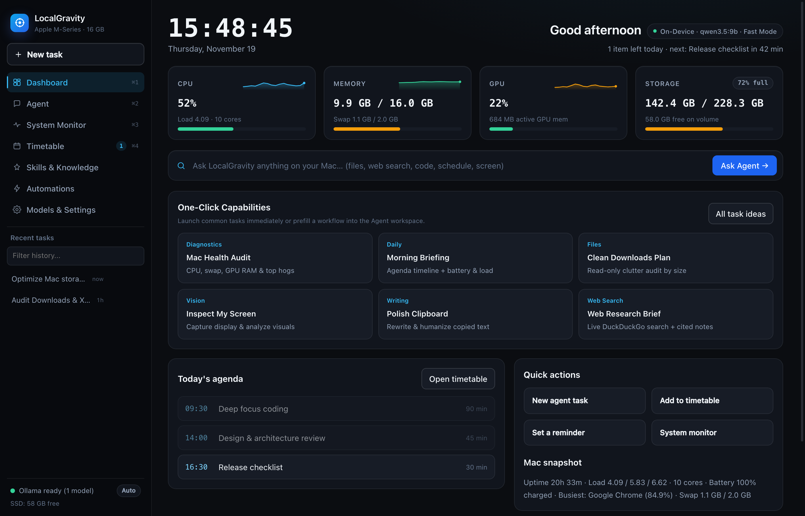
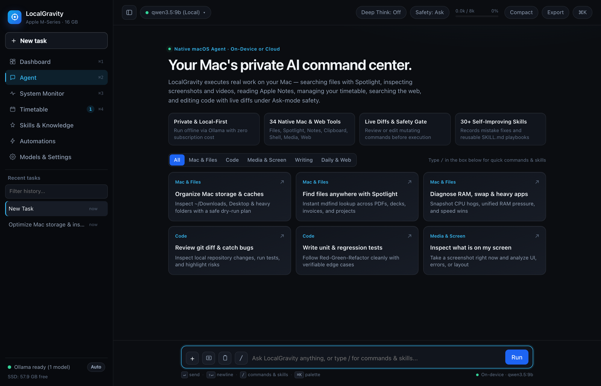
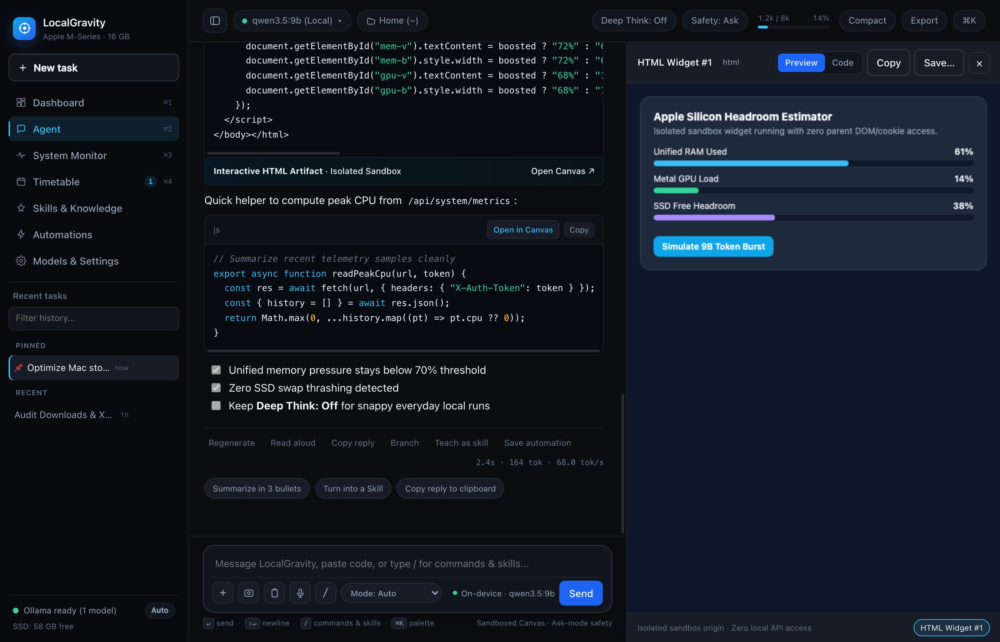
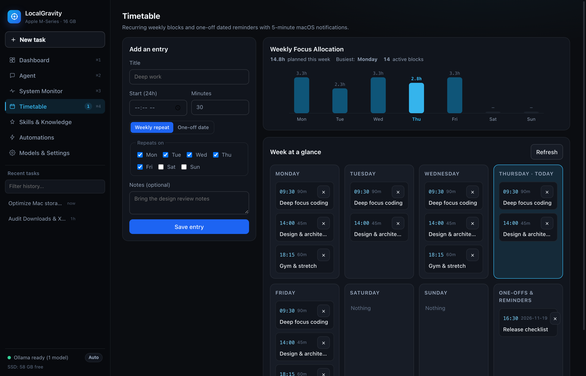

<div align="center">

# LocalGravity

**A native macOS AI command center for local Ollama and cloud models — zero npm dependencies.**

[](https://github.com/Thush099/LocalGravity/actions/workflows/ci.yml)
[](LICENSE)
[](#quick-start)
[](#quick-start)
[](#architecture)

</div>

LocalGravity combines a compiled Swift `WKWebView` macOS shell with a dependency-free Node.js agent runtime. Run privately offline with [Ollama](https://ollama.com) or connect OpenRouter, Groq, Google Gemini, Anthropic Claude, OpenAI, or any OpenAI-compatible API. Beyond multi-turn coding and file work, it gives you a live Apple Silicon telemetry dashboard with SVG graphs, **48 native Mac and web tools** (Spotlight search, screen capture, Apple Notes, live web search, shell, ffmpeg/ImageMagick media inspection, timetable CRUD), **30 starter skills**, persistent memory, and scheduled `launchd` background jobs.

<p align="center">
  
</p>

---

## Why LocalGravity?

Most AI tools force a compromise: browser chats are siloed from your Mac and charge monthly fees, while terminal-only CLIs hide visuals, file diffs, and system telemetry. LocalGravity closes that gap cleanly:

| Capability | Browser AI Chat | Terminal CLI | LocalGravity |
| --- | --- | --- | --- |
| **Zero-subscription local models** | No | Sometimes | **Yes** (Ollama tuned for 16 GB Apple Silicon + 1-click RAM unload) |
| **Live split-pane Artifact Canvas** | Cloud-only | None | **Side-by-side HTML/SVG preview in an isolated sandbox + Save/Copy** |
| **Native Mac control (48 tools)** | None | Shell only | **Per-chat project folders, Spotlight, Notes, Clipboard, Screenshots, Shortcuts, Web** |
| **Full conversation control & modes** | Varies | Rare | **Inline Edit & re-run, Branch, Pin/Rename, Engineer/Researcher/Writer/Mac Ops modes** |
| **Live hardware & schedule visibility** | None | None | **Real-time SVG CPU/RAM/GPU graphs, Memory donut & Timetable** |
| **Voice, LaTeX & persistent skills** | Paid / online | Flags only | **Offline macOS Read Aloud, zero-dep LaTeX math, callouts, 30+ `SKILL.md` & `LEARNED_FIXES.md`** |

---

## Interface tour

<table>
  <tr>
    <td width="50%">
      <strong>Command Center Welcome</strong><br />
      <sub>Categorized task starters, Agent Modes (<code>Auto</code>, <code>Engineer</code>, <code>Researcher</code>, <code>Writer</code>, <code>Mac Ops</code>), project workspace folder picker, microphone dictation, and <code>/</code> slash command autocomplete.</sub>
      <br /><br />
      
    </td>
    <td width="50%">
      <strong>Editorial Agent Workspace</strong><br />
      <sub>Pinned/Recent sidebar groups, live task plans, collapsible multi-tool summaries, GitHub callouts, zero-dependency LaTeX math, GFM tables, and inline Edit/Regenerate/Branch/Read Aloud actions.</sub>
      <br /><br />
      
    </td>
  </tr>
  <tr>
    <td width="50%">
      <strong>Live Split-Pane Artifact Canvas</strong><br />
      <sub>Preview HTML/SVG widgets side-by-side in a sandboxed iframe (<code>sandbox="allow-scripts"</code> with isolated origin), toggle to highlighted Code view, Copy, or Save via native macOS dialog.</sub>
      <br /><br />
      
    </td>
    <td width="50%">
      <strong>System Monitor &amp; Live SVG Graphs</strong><br />
      <sub>60-sample CPU/Memory/GPU telemetry curve with filter tabs, Unified Memory composition donut, swap &amp; Ollama VRAM monitor, and CPU/Memory process sort.</sub>
      <br /><br />
      
    </td>
  </tr>
  <tr>
    <td width="50%">
      <strong>Timetable &amp; Focus Analytics</strong><br />
      <sub>Weekly focus-hour SVG distribution bar chart, recurring weekly blocks, one-off dated reminders, and 5-minute macOS notifications.</sub>
      <br /><br />
      
    </td>
    <td width="50%">
      <strong>Skills &amp; Knowledge Base</strong><br />
      <sub>30 starter <code>SKILL.md</code> playbooks, local library browser, GitHub URL import/refresh, self-learned mistake rules (<code>LEARNED_FIXES.md</code>), persistent <code>MEMORY.md</code>, and Obsidian Dark / Porcelain Light themes.</sub>
      <br /><br />
      
    </td>
  </tr>
</table>

---

## Quick start

Requirements: Apple Silicon Mac on macOS 14+, Node.js 22+, and Xcode Command Line Tools (`swiftc`). No `npm install` step is needed.

```bash
git clone https://github.com/Thush099/LocalGravity.git
cd LocalGravity
npm run check
npm run build:app
```

`npm run build:app` compiles the Swift host, bundles the backend and UI, applies ad-hoc code signing, and installs `/Applications/LocalGravity.app` (or `build/LocalGravity.app` if `/Applications` is not writable). Open LocalGravity from Spotlight or Launchpad.

For local inference and optional media tools:

```bash
brew install ollama ffmpeg imagemagick
ollama serve
ollama pull qwen3.5:4b   # Fast daily driver on 16 GB Macs (~3 GB RAM)
# or: ollama pull qwen3.5:9b   # Stronger local reasoning (~7.6 GB),
#                             # noticeably slower on busy 16 GB Macs
```

Cloud provider keys can be added in **Models & Settings** (`⌘K` -> Settings) and are stored locally in `~/.localgravity/config.json` with `0600` permissions.

---

## Key capabilities

### Engine & Performance on 16 GB Macs
- **Turn-0 local overhead under 1,200 tokens:** Intent-aware tool routing (`backend/agent/tool-selector.mjs`) sends local Ollama models no tools at all for plain conversation, a minimal file/task core for everyday requests ("What is in this folder?", "Read the README", "Fix this"), and domain tool groups only when the request calls for them (or when you select `Engineer`, `Researcher`, `Writer`, or `Mac Ops`). The skill catalog is listed name-only in compact mode, keeping Turn-0 overhead under 1,200 tokens even with all 30 starter skills installed.
- **Zero mid-turn `terminated` timeouts:** Local Ollama streams over a dedicated `node:http` socket (`setTimeout(0)`, `TCP_NODELAY`) rather than hitting `undici`'s 5-minute cutoff, paired with 15-second SSE keepalives and automatic retry on transient local disconnects.
- **Warm-on-focus model readiness:** Focusing the composer quietly pre-loads the configured Ollama model (`keep_alive: 15m`, bounded to a 180 s timeout) so the first reply skips the cold model load. Concurrent requests coalesce into one warm-up, model switches and explicit unloads cancel stale ones, chat never blocks on a failed warm-up, and the live status shows **Warming up model** while the load is in flight (`POST /api/models/ollama/warm`, `GET /api/models/ollama/warm/status`).
- **One-click GPU RAM recovery:** Both the Dashboard and System Monitor show resident Ollama GPU memory and swap pressure, with an **Unload model (Free RAM)** action (`keep_alive: 0`) that frees unified memory immediately.
- **Fast mode vs. Deep Think:** Toggle **Deep Think: Off / On** directly in the header, and track exact context window usage across the `8K` / `16K` / `32K` budget with automatic compaction at 70%.

### Split-Pane Artifact Canvas, Workspaces & Chat UX
- **Live Split-Pane Artifact Canvas:** Any HTML or SVG block renders live next to the conversation inside `/preview-sandbox/:id` with an isolated `<iframe sandbox="allow-scripts">` origin and zero parent DOM or API access. Switch between Preview and syntax-highlighted Code views, browse multiple artifacts from a single chat, copy source, or export to disk via macOS Save panel.
- **Per-Chat Project Folders & Conversation Control:** Pick any local directory from the workspace header (`NSOpenPanel` in the Mac app) to scope tools cleanly to that repository. Inline **Edit & re-run** truncates and replays from that prompt, **Regenerate** reruns clean from the previous turn, **Branch** forks the conversation into a separate session up to any message, and sidebar **Pin / Rename** keeps key threads at the top.
- **Agent Modes, Scientific Markdown, Dictation & Offline Voice:** Tailor behavior per chat (`Auto`, `Engineer`, `Researcher`, `Writer`, `Mac Ops`); render `$$...$$` display math, inline `$...$` formulas (without misfiring on prices like `$149.00`), and GitHub `[!NOTE]` / `[!TIP]` / `[!IMPORTANT]` / `[!WARNING]` / `[!CAUTION]` callouts; dictate prompts from the microphone; or listen to replies offline via macOS `say` (`Read aloud` / `Stop reading`).
- **48 Built-In Mac & Web Tools:** Files (`list_dir`, `read_file`, `write_file`, `edit_file`, `move_file`, `undo_file_moves`, `search_files`, `spotlight_search`, `run_command` — file moves are journaled and reversible, with a read-only `organize_plan` preview first that sorts loose files by filename and content into folders like Screenshots, Installers, Fonts, and Logs — not just by extension), web & knowledge (`search_web`, `fetch_url`, `open_url`, `briefing`, `MEMORY.md` & Knowledge CRUD), media & screen (`take_screenshot`, `inspect_media`), and macOS automation (`manage_notes`, clipboard, notifications, apps, Shortcuts, AppleScript, reminders, calculator, plan updates, system stats, and timetable CRUD).

### Proactive Assistance, Grounded in Real Observations
- **Grounded briefing & follow-up suggestions:** `briefing` composes live system metrics with today's schedule entries into a short situational readout (pressure points first). Every flag suggests a concrete next step that names the real tool that would do it — `storage 92% full` → **find large files** (`tool: large_files`) — and suggestions only ever appear alongside an observed flag. Nothing is invented.
- **Environmental alerts with an attention budget:** a 15-minute background check warns about disk pressure, memory & swap, thermal pressure and battery (never while charging), honoring quiet hours (23:00–07:00), a 3-hour per-topic cooldown and a 6-alert daily cap. High-severity alerts still break through the quiet; ordinary warnings never nag (`LOCALGRAVITY_DISABLE_AMBIENT_ALERTS=1`).
- **Explicit memory capture:** say "remember that I prefer tabs", "note: the staging box is 10.0.0.5" or "my name is Thushanth" in any message and the fact lands verbatim in `MEMORY.md` — idempotent, single-line facts only (so memory can never smuggle instructions into the system prompt), and the turn tells the model the write landed, so the reply confirms it instead of guessing. The injected memory stays budgeted and question-aware — the facts most relevant to what you just asked (or the curated standing head) plus the most recent captures, with an explicit truncation marker — so a growing `MEMORY.md` never crowds out the context window yet still answers questions about older facts.
- **Forgetting:** "forget that the staging box is 10.0.0.5" removes exactly one matching bullet from `MEMORY.md`, before memory is loaded for that turn — so the fact is gone from the same reply that confirms it. Only a real instruction counts ("forget it" deletes nothing), and a target that matches two entries removes neither: the turn is told to ask which one. Headings, tags and unrelated facts are left alone.
- **Standing preferences:** durable instructions in your own words — "from now on use pnpm", "always run the tests before committing", "never force-push to main" — are recognised deterministically at turn start and stored verbatim as a single bullet under `## Standing Preferences` in `MEMORY.md`, placed ahead of older facts so the budgeted prompt always keeps them. Casual speech never matches ("I always forget…", "always the same problem"), the stored rule is your words, never a summary. A captured fact and a captured rule both report the save back to the model, so a confirmation always follows a real write.
- **Plan accountability:** when a reply publishes a numbered plan and later turns skip steps, the agent nudges itself once per step (`[Self-Correction]`) and reports completed steps in later plans — plans do not silently rot.
- **Goal continuity across sessions:** published plans are persisted as open goals (`state/agent-goals.json`, 0600, keyed by session), and when a later message is actually about that work — "where were we?", "what is left", or a question overlapping the plan's own steps — the unfinished steps are re-surfaced so the agent can honestly pick up where it left off. Records only ever contain the model's own published steps; completing every step clears the goal.
- **Goal decomposition & completion verification:** acting on a compound request (a list of items or "then…" sequencing) without a published plan gets one nudge to break it into concrete steps first; and a step marked done is checked against the turn's real tool log — a claim with no observable action behind it is nudged to verify or restate honestly, and keeps an `(unverified)` marker in the goal record so later turns see it. A plan is a claim, never its own evidence.
- **Turn receipts:** a change that did not happen is never reported as done. A blocked, denied, unparseable or failed write is named before the answer lands (`[Self-Correction]`), and if the reply still never mentions it, a factual `[Unreported failures]` line carries the tool's own error. Non-zero command exits stay what they are — observations, not blocked actions.
- **Voice barge-in:** starting a new message mid-reply stops any in-flight `say` speech immediately — talk over the assistant like a real interlocutor.

### Security & Runtime Hardening
- **Authenticated loopback API:** Fresh 32-byte per-launch `X-Auth-Token` bound strictly to `127.0.0.1` on an ephemeral port (also required on `/api/artifacts/stage`, `/api/chat/speak`, and session mutations).
- **Isolated Artifact Sandbox & CSRF defenses:** Mutating routes reject foreign `Origin` headers. The main UI enforces strict `script-src 'self'; frame-src 'self'` CSP, while `/preview-sandbox/:id` enforces `sandbox allow-scripts; default-src 'none'; script-src 'unsafe-inline'; style-src 'unsafe-inline'; img-src data: blob:; font-src data:; frame-ancestors 'self'` so previewed widgets cannot read parent state or local endpoints.
- **Unified SSRF & redirect protection (`backend/net-guard.mjs`):** Blocks loopback, RFC1918, CGNAT, link-local/cloud metadata (`169.254.169.254`), `.local`/`.internal`, and IPv6 private/IPv4-mapped hosts, and validates every `3xx` redirect hop manually across `search_web`, `fetch_url`, skill URL imports, and knowledge URL imports.
- **Approval gate & child supervision:** **Ask** mode pauses mutating tools for user approval with editable previews, and known catastrophic command chains are blocked. Swift supervises the Node server via `stdin` pipe + `LOCALGRAVITY_PARENT_PID` and cleans up any active `/usr/bin/say` child on exit.
- **Stalled-stream watchdog:** local Ollama streams run with zero socket timeouts so heavy prefill is never killed. A separate idle guard stops the turn with a clear message if the model sends **no bytes for 3 minutes** (out of memory, wedged runner) instead of leaving the UI spinning forever. Override with `LOCALGRAVITY_STREAM_IDLE_MS` on slower machines.

---

## Keyboard shortcuts

| Shortcut | Action |
| --- | --- |
| `⌘K` | Open Command Palette (also in View menu) |
| `⌘N` | Create New Task (also in File menu) |
| `⌘1` – `⌘4` | Switch between Dashboard, Agent, System Monitor, and Timetable |
| `⌘\` | Toggle collapsible sidebar (floating expand button appears when hidden) |
| `⌘↵` | Send message (or queue follow-up while a run is active) |
| `⌘⇧E` | Export current conversation to Markdown via native Save dialog |
| `/` (in composer) | Open interactive Slash Command & Skill autocomplete menu |
| `⌘/` | Show keyboard shortcuts sheet |
| `Esc` | Close active slash menu, Artifact Canvas, dialog, palette, or overlay |

---

## Architecture

```text
┌──────────────────────────────────────────────────────────────────┐
│  /Applications/LocalGravity.app  (Swift 6 / AppKit / WKWebView)  │
│  • Obsidian canvas (zero white launch flash)                     │
│  • Native Finder drag-and-drop, NSOpenPanel, NSSavePanel export  │
│  • 32-byte per-launch X-Auth-Token + stdin/PID child supervision │
└───────────────────────────────┬──────────────────────────────────┘
                                │ http://127.0.0.1:<ephemeral> (HTTP + SSE)
┌───────────────────────────────▼──────────────────────────────────┐
│  Node.js 22+ Agent Runtime  (Zero external npm dependencies)     │
│  ├── backend/server.mjs          (Auth HTTP/SSE + 60pt telemetry)│
│  ├── backend/cli-run.mjs         (Headless launchd runner)       │
│  ├── backend/net-guard.mjs       (SSRF + redirect-hop validator) │
│  ├── backend/system-monitor.mjs  (CPU, RAM, swap, GPU, procs)    │
│  ├── backend/schedule.mjs        (Weekly + one-off timetable)    │
│  ├── backend/agent/              (ReAct loop, tool-selector,     │
│  │                                prompt builder, compactor)     │
│  ├── backend/providers/          (Ollama stream, OpenAI, Claude) │
│  ├── backend/tools/              (48 tools + safety policies)    │
│  ├── backend/skills-engine.mjs   (30 starter SKILL.md + imports) │
│  └── backend/knowledge-engine.mjs(MEMORY.md + docs search)       │
└───────────────────────────────┬──────────────────────────────────┘
                                │
        ┌───────────────────────┼───────────────────────┐
        ▼                       ▼                       ▼
  Ollama (Local)         macOS System & CLI       Cloud Providers
  qwen3.5:4b / 9b        mdfind, screencapture,   OpenRouter, Groq,
  gemma4, etc.           osascript, shortcuts     Gemini, Claude, OpenAI
```

---

## Checks and CI

Run the full local check suite (unit/integration tests, JavaScript syntax checks, and shell syntax checks):

```bash
npm run check
```

Every push and pull request runs [`.github/workflows/ci.yml`](.github/workflows/ci.yml) on `macos-15`, verifying both `npm run check` and a complete native Swift `.app` bundle build (`plutil -lint` + `codesign --verify --deep --strict`).

---

## Clean uninstall

All runtime data stays strictly inside `/Applications/LocalGravity.app`, `~/.localgravity/`, and `~/Library/LaunchAgents/com.localgravity.*.plist`.

```bash
bash scripts/uninstall.sh
```

Pass `--purge-models` to also remove downloaded local models and optional Homebrew tools.

---

## License

[MIT](LICENSE)
