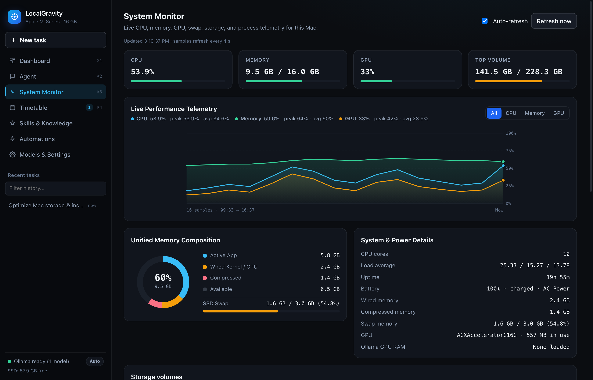

<div align="center">

# LocalGravity

**A native macOS AI command center for local Ollama and cloud models — zero npm dependencies.**

[](https://github.com/Thush099/LocalGravity/actions/workflows/ci.yml)
[](LICENSE)
[](#quick-start)
[](#quick-start)
[](#architecture)

</div>

LocalGravity combines a compiled Swift `WKWebView` macOS shell with a dependency-free Node.js agent runtime. Run privately offline with [Ollama](https://ollama.com) or connect OpenRouter, Groq, Google Gemini, Anthropic Claude, OpenAI, or any OpenAI-compatible API. Beyond multi-turn coding and file work, it gives you a live Apple Silicon telemetry dashboard with SVG graphs, **34 native Mac and web tools** (Spotlight search, screen capture, Apple Notes, live web search, shell, ffmpeg/ImageMagick media inspection, timetable CRUD), **30 starter skills**, persistent memory, and scheduled `launchd` background jobs.

<p align="center">
  
</p>

---

## Why LocalGravity?

Most AI tools force a compromise: browser chats are siloed from your Mac and charge monthly fees, while terminal-only CLIs hide visuals, file diffs, and system telemetry. LocalGravity closes that gap cleanly:

| Capability | Browser AI Chat | Terminal CLI | LocalGravity |
| --- | --- | --- | --- |
| **Zero-subscription local models** | No | Sometimes | **Yes** (Ollama tuned for 16 GB Apple Silicon + 1-click RAM unload) |
| **Native Mac control (34 tools)** | None | Shell only | **Files, Spotlight, Notes, Clipboard, Screenshots, Shortcuts, Web** |
| **Live hardware & schedule visibility** | None | None | **Real-time SVG CPU/RAM/GPU graphs, Memory donut & Timetable** |
| **Visual inspection & safety gate** | Uploads only | Text-only | **Video/screen vision inspection, syntax diffs & Ask-mode approval** |
| **Persistent skills & auto-learning** | Locked in cloud | Manual flags | **30 starter `SKILL.md` playbooks, GitHub imports & `LEARNED_FIXES.md`** |

---

## Interface tour

<table>
  <tr>
    <td width="50%">
      <strong>Command Center Welcome</strong><br />
      <sub>Clear capabilities strip, categorized task starters, one-click Screen &amp; Clipboard composer buttons, and <code>/</code> slash command autocomplete.</sub>
      <br /><br />
      
    </td>
    <td width="50%">
      <strong>Agent Workspace</strong><br />
      <sub>Live task plans, collapsible multi-tool summaries, syntax-highlighted code blocks, GFM tables, turn speed telemetry, and follow-up chips.</sub>
      <br /><br />
      
    </td>
  </tr>
  <tr>
    <td width="50%">
      <strong>System Monitor &amp; Live SVG Graphs</strong><br />
      <sub>60-sample CPU/Memory/GPU telemetry curve with filter tabs, Unified Memory composition donut, swap &amp; Ollama VRAM monitor, and CPU/Memory process sort.</sub>
      <br /><br />
      
    </td>
    <td width="50%">
      <strong>Timetable &amp; Focus Analytics</strong><br />
      <sub>Weekly focus-hour SVG distribution bar chart, recurring weekly blocks, one-off dated reminders, and 5-minute macOS notifications.</sub>
      <br /><br />
      
    </td>
  </tr>
  <tr>
    <td colspan="2">
      <strong>Skills &amp; Knowledge Base</strong><br />
      <sub>30 starter <code>SKILL.md</code> playbooks, local library browser, GitHub URL import/refresh, self-learned mistake rules (<code>LEARNED_FIXES.md</code>), persistent <code>MEMORY.md</code>, and Obsidian Dark / Porcelain Light themes.</sub>
      <br /><br />
      
    </td>
  </tr>
</table>

---

## Quick start

Requirements: Apple Silicon Mac on macOS 14+, Node.js 22+, and Xcode Command Line Tools (`swiftc`). No `npm install` step is needed.

```bash
git clone https://github.com/Thush099/LocalGravity.git
cd LocalGravity
npm run check
npm run build:app
```

`npm run build:app` compiles the Swift host, bundles the backend and UI, applies ad-hoc code signing, and installs `/Applications/LocalGravity.app` (or `build/LocalGravity.app` if `/Applications` is not writable). Open LocalGravity from Spotlight or Launchpad.

For local inference and optional media tools:

```bash
brew install ollama ffmpeg imagemagick
ollama serve
ollama pull qwen3.5:4b   # Fast daily driver on 16 GB Macs (~3 GB RAM)
# or: ollama pull qwen3.5:9b   # Stronger local reasoning (~7.6 GB)
```

Cloud provider keys can be added in **Models & Settings** (`⌘K` -> Settings) and are stored locally in `~/.localgravity/config.json` with `0600` permissions.

---

## Key capabilities

### Engine & Performance on 16 GB Macs
- **61% lower Turn-0 overhead on Ollama:** Turn-aware tool routing (`backend/agent/tool-selector.mjs`) sends a focused 10-tool core on local models and activates domain tool groups (web search, Spotlight, screenshots, Apple Notes, media, schedule, knowledge) on demand while keeping them sticky across a session for KV-cache reuse. Combined with compact local skill indexing, Turn-0 fixed overhead drops from ~6,002 tokens to ~2,328 tokens.
- **Zero mid-turn `terminated` timeouts:** Local Ollama streams over a dedicated `node:http` socket (`setTimeout(0)`, `TCP_NODELAY`) rather than hitting `undici`'s 5-minute cutoff, paired with 15-second SSE keepalives and automatic retry on transient local disconnects.
- **One-click GPU RAM recovery:** Both the Dashboard and System Monitor show resident Ollama GPU memory and swap pressure, with an **Unload model (Free RAM)** action (`keep_alive: 0`) that frees unified memory immediately.
- **Fast mode vs. Deep Think:** Toggle **Deep Think: Off / On** directly in the header, and track exact context window usage across the `8K` / `16K` / `32K` budget with automatic compaction at 70%.

### 34 Built-In Tools & Everyday Workflows
- **Files, Code & Search:** `list_dir`, `read_file`, `write_file`, `edit_file`, `search_files`, **`spotlight_search`** (`mdfind` index lookup across the entire Mac), and `run_command`.
- **Live Web & Knowledge:** **`search_web`** (API-key-free public DuckDuckGo search), `fetch_url`, **`open_url`**, and full CRUD/search over `MEMORY.md` and Knowledge Base documents.
- **Vision, Screen & Media:** **`take_screenshot`** (silent macOS capture scaled for model vision) and `inspect_media` (extracts keyframes via `ffmpeg` or resizes photos via `sips`).
- **macOS Native Actions:** **`manage_notes`** (list, search, read, or create Apple Notes via argument-isolated AppleScript), `copy_to_clipboard` / `paste_from_clipboard`, `show_notification`, `open_app`, `run_shortcut`, `run_applescript`, `set_reminder`, `calculate` (injection-safe math parser), `update_plan`, `system_stats`, and timetable CRUD (`add_schedule_item`, `list_schedule_items`, `remove_schedule_item`).
- **World-Class Chat UX:** Type `/` for instant **slash-command & skill autocomplete** (`/health`, `/brief`, `/screenshot`, `/clipboard`, `/clean`, `/web`, `/spotlight`, `/notes`, `/compact`, `/export`, `/unload`, plus all 30+ installed skills). Use composer buttons to capture screenshots or insert clipboard text in one click, queue multiple follow-up messages while streaming, inspect collapsible multi-tool summaries and syntax-highlighted code blocks, track per-turn `tok/s` telemetry, click context-aware follow-up chips, or switch between **Auto / Obsidian Dark / Porcelain Light** themes.

### Security & Runtime Hardening
- **Authenticated loopback API:** Fresh 32-byte per-launch `X-Auth-Token` bound strictly to `127.0.0.1` on an ephemeral port.
- **Browser & CSRF defenses:** Mutating routes reject foreign `Origin` headers; UI enforces `script-src 'self'` CSP alongside `nosniff` and `DENY`.
- **Unified SSRF & redirect protection (`backend/net-guard.mjs`):** Blocks loopback, RFC1918, CGNAT, link-local/cloud metadata (`169.254.169.254`), `.local`/`.internal`, and IPv6 private/IPv4-mapped hosts, and validates every `3xx` redirect hop manually across `search_web`, `fetch_url`, skill URL imports, and knowledge URL imports.
- **Approval gate & child supervision:** **Ask** mode pauses mutating tools (file writes outside managed state, shell commands, AppleScript, Shortcuts, creating Apple Notes) for user approval, and known catastrophic command chains are blocked. Swift supervises the Node server via `stdin` pipe + `LOCALGRAVITY_PARENT_PID` so the backend exits immediately when the app quits.

---

## Keyboard shortcuts

| Shortcut | Action |
| --- | --- |
| `⌘K` | Open Command Palette (tasks, skills, knowledge, theme, RAM actions) |
| `⌘1` – `⌘4` | Switch between Dashboard, Agent, System Monitor, and Timetable |
| `⌘\` | Toggle collapsible sidebar (floating expand button appears when hidden) |
| `⌘↵` | Send message (or queue follow-up while a run is active) |
| `⌘⇧E` | Export current conversation to Markdown via native Save dialog |
| `/` (in composer) | Open interactive Slash Command & Skill autocomplete menu |
| `⌘/` | Show keyboard shortcuts sheet |
| `Esc` | Close active slash menu, dialog, palette, or overlay |

---

## Architecture

```text
┌──────────────────────────────────────────────────────────────────┐
│  /Applications/LocalGravity.app  (Swift 6 / AppKit / WKWebView)  │
│  • Obsidian canvas (zero white launch flash)                     │
│  • Native Finder drag-and-drop, NSOpenPanel, NSSavePanel export  │
│  • 32-byte per-launch X-Auth-Token + stdin/PID child supervision │
└───────────────────────────────┬──────────────────────────────────┘
                                │ http://127.0.0.1:<ephemeral> (HTTP + SSE)
┌───────────────────────────────▼──────────────────────────────────┐
│  Node.js 22+ Agent Runtime  (Zero external npm dependencies)     │
│  ├── backend/server.mjs          (Auth HTTP/SSE + 60pt telemetry)│
│  ├── backend/cli-run.mjs         (Headless launchd runner)       │
│  ├── backend/net-guard.mjs       (SSRF + redirect-hop validator) │
│  ├── backend/system-monitor.mjs  (CPU, RAM, swap, GPU, procs)    │
│  ├── backend/schedule.mjs        (Weekly + one-off timetable)    │
│  ├── backend/agent/              (ReAct loop, tool-selector,     │
│  │                                prompt builder, compactor)     │
│  ├── backend/providers/          (Ollama stream, OpenAI, Claude) │
│  ├── backend/tools/              (34 tools + safety policies)    │
│  ├── backend/skills-engine.mjs   (30 starter SKILL.md + imports) │
│  └── backend/knowledge-engine.mjs(MEMORY.md + docs search)       │
└───────────────────────────────┬──────────────────────────────────┘
                                │
        ┌───────────────────────┼───────────────────────┐
        ▼                       ▼                       ▼
  Ollama (Local)         macOS System & CLI       Cloud Providers
  qwen3.5:4b / 9b        mdfind, screencapture,   OpenRouter, Groq,
  gemma4, etc.           osascript, shortcuts     Gemini, Claude, OpenAI
```

---

## Checks and CI

Run the full local check suite (unit/integration tests, JavaScript syntax checks, and shell syntax checks):

```bash
npm run check
```

Every push and pull request runs [`.github/workflows/ci.yml`](.github/workflows/ci.yml) on `macos-15`, verifying both `npm run check` and a complete native Swift `.app` bundle build (`plutil -lint` + `codesign --verify --deep --strict`).

---

## Clean uninstall

All runtime data stays strictly inside `/Applications/LocalGravity.app`, `~/.localgravity/`, and `~/Library/LaunchAgents/com.localgravity.*.plist`.

```bash
bash scripts/uninstall.sh
```

Pass `--purge-models` to also remove downloaded local models and optional Homebrew tools.

---

## License

[MIT](LICENSE)
